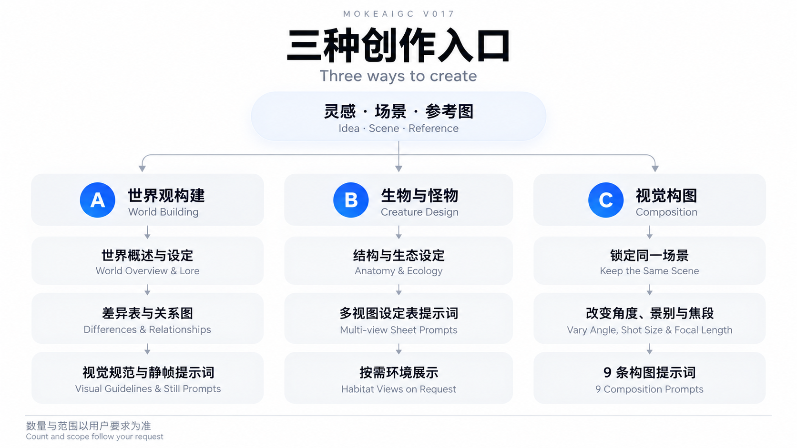
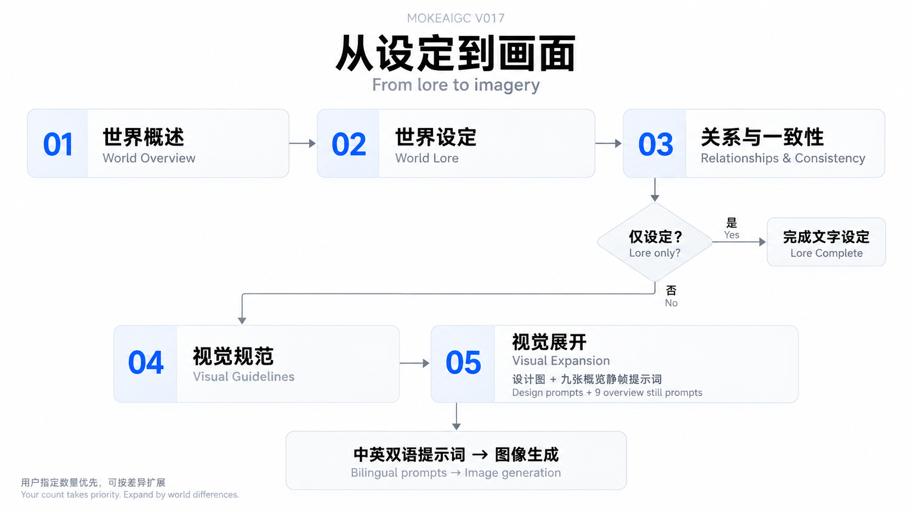

# MOKEAIGC V017 · 世界观构建导演

**从一句灵感出发，构建一个可信的想象世界，再用电影剧照式提示词让它被看见。**

*Cinematic World-Building Director*

一场永不停歇的雨、一座废弃的沙漠修道院、一种陌生文化，或一张让你想继续探索的参考图，都可以成为起点。MOKEAIGC V017 先解释这个世界如何运行、居民如何生活，再将设定转化为视觉连贯的场景——像从同一部“未拍摄电影”中截取的画面。

**[打开 V017 完整指令 →](MOKEAIGC-work%20V017%20.md)**

本仓库提供可供 AI 助手读取的 Markdown 创作指令。主要交付世界设定与图像提示词；生成实际图像需要使用相应图像工具。

## 选择你的创作入口




| 你想做什么 | 使用模式 | 主要交付 |
| --- | --- | --- |
| 把灵感或参考图扩展为一个世界 | **A · 世界观构建**（默认） | 世界概述、设定正文、差异表、Mermaid 关系图、视觉规范与中英双语静帧提示词 |
| 设计物种、怪物、异兽或坐骑 | **B · 生物与怪物设计** | 生物设定摘要、中英双语多视图设定表提示词；按需增加栖息地展示 |
| 探索同一个场景的不同拍法 | **C · 视觉构图探索** | 默认 9 条构图方案，包含具体焦段和中英双语完整提示词 |

适合世界观创作、影视提案、游戏世界设定与视觉前期探索。视频运动提示词、单个角色身份设定，以及玩法、关卡和任务系统设计不属于默认交付范围。

## 快速开始

1. 打开 [V017 完整指令](MOKEAIGC-work%20V017%20.md)，复制全文，放入 AI 助手的自定义指令，或作为本次对话的参考文档。若工具支持 Skill，可按该工具要求配置技能文件与目录。
2. 输入一句灵感、一段描述或一张参考图，并说明希望构建世界、设计生物，还是探索构图。
3. 有明确要求时，补充平台、画幅、数量、风格或已有设定；没有这些信息也可以开始。
4. 将交付的图像提示词用于 Midjourney、Nano Banana Pro、GPT Image 2 等工具，并在对应工具中设置画幅。

无需先填写一整套世界观问卷。你可以直接从下面的示例开始。

### A · 从灵感构建世界




```text
请按 MOKEAIGC V017 的世界观模式，构建一个雨永不停歇的世界。
居民住在悬崖上的垂直聚落，靠收集雨水和修补旧机械生活。
重点解释资源、交通、信仰与阶层之间的关系，并完成默认视觉展开。
```

默认会依次交付：

- **世界概述**：名称、核心前提、气质、范围与边界。
- **世界设定正文**：按题材展开规律、环境、社会、文化、历史与势力，解释它们如何共同塑造生活。
- **关系与一致性说明**：检查关键因果关系，区分客观事实、居民信念、传闻与刻意保留的未知；附世界差异表与可编辑的 Mermaid 关系图。
- **视觉展开**：形态、材料、配色、结构、尺度与状态变化规范，代表性设计图提示词，以及默认九张世界概览的中英双语静帧提示词。

九张概览分别从**居民、动物、建筑、地景、日常、迁徙或运动、声音或文化、权力或张力、肖像**揭示世界。重要地域、群体或历史差异可以继续分组扩展；总数不固定，用户指定数量优先。

只需要文字设定时：

```text
请构建一个依靠地下热泉生存的极寒文明，仅设定，不做视觉展开。
```

### B · 设计生物与怪物

```text
请按生物与怪物设计模式，为上述雨世界设计一种攀爬悬崖的运输坐骑。
说明身体结构、尺寸、运动方式、环境适应与生态关系。
提供比例和器官位置一致的中英双语多视图设定表提示词。
```

已有世界设定会作为设计约束。多视图设定表采用中性背景、清晰照明和尺度参照；需要栖息地中的电影静帧时，可以单独提出。

### C · 探索同一场景的构图

```text
请按视觉构图模式，探索“旅人在废弃天文台中仰望破裂穹顶”这一场景。
保持人物、地点与核心事件一致，给出 9 种不同拍法。
通过镜头高度、景别、焦段、前景遮挡和负空间拉开差异。
```

每条方案包含标题、构图概念与中英双语完整提示词。这个模式围绕同一场景改变拍法，不强制补写一整套世界设定。

### 从参考图开始，或继续已有设定

上传图片后，可以这样输入：

```text
请从这张参考图的材料、建筑、光线与生活痕迹出发，构建它所属的世界。
保留图中最重要的视觉特征，并解释它们与环境、资源及文化的关系。
```

继续创作时，可以只指定一处：

```text
沿用已有世界设定，只补充北部港口的运输制度与生活场景。
这次输出 4 条 GPT Image 2 静帧提示词，画幅 3:4，不重复其他章节。
```

## 默认配置与可调整项

| 项目 | 默认行为 | 如何调整 |
| --- | --- | --- |
| 图像平台 | Midjourney | 指定 Nano Banana Pro、GPT Image 2 或其他平台 |
| 画幅 | 16:9，在输出顶部标注 | 指定其他比例，并在图像工具中设置 |
| 数量 | A 首轮 9 张概览；C 为 9 条构图方案 | 指定数量或子集；A 可按重要设定差异扩展 |
| 基础风格 | 电影剧照式、胶片质感与可信的材料痕迹 | 指定其他基础风格；可选叠加“科幻浪漫极简”基调 |
| 电影静帧相机预设 | Arri 65mm camera、Cooke anamorphic lenses、analog film stock | 指定自己的相机、镜头与底片配置 |
| 镜头焦距 | 每张静帧明确选择具体焦段 | 指定焦段，或让它随叙事与构图变化 |
| 提示词语言 | 中英双语，内容信息等价 | 描述性内容翻译；功能性固定串保留英文 |
| Midjourney 参数 | 不自动追加画幅、版本或风格化参数 | 提供 `--sref`、`--profile` 时沿用；其他参数按明确要求添加 |

**用户明确指定的数量、构图、风格、相机与范围优先于默认配置。** 详细规则以 [V017 完整指令](MOKEAIGC-work%20V017%20.md) 为准。

## 视觉交付如何使用

模式 A 的每张电影静帧包含**世界观备注、摄影（中英）、灯光（中英）、完整英文提示词与中文提示词**。完整提示词可独立使用，摄影和灯光字段方便单独审阅或调整。

不同用途采用不同规则：

- **电影静帧**强调场景中的动作、情绪、纵深与生活痕迹，让画面揭示既定世界。
- **结构设计图与生物多视图设定表**强调完整结构、清晰照明、比例一致和尺度参照，不套用电影静帧的浅景深与构图限制。
- **色卡**默认提供色名、HEX 色值与用途。明确要求色卡图片时，指令会要求 AI 使用可用绘图工具制作实际图片；执行结果取决于所用工具的能力。

## 仓库文件与版本

| 文件 | 用途 |
| --- | --- |
| [MOKEAIGC-work V017 .md](MOKEAIGC-work%20V017%20.md) | 当前版本；包含完整世界设定流程、三种模式与视觉交付规则 |
| [MOKEAIGC-work V09 .md](MOKEAIGC-work%20V09%20.md) | 历史版本，供回顾与对照 |
| [README.md](README.md) | 使用入口、示例与作品展示 |

V017 将世界设定放在视觉展开之前，增加差异表、关系图与视觉规范，并区分电影静帧、结构设计图、多视图设定表和色卡的适用规则。当前版本可独立使用，无需同时加载 V09。

## 作品展示

以下保留仓库原有作品图，供浏览视觉效果。

<details>
<summary>展开作品图集</summary>


</details>

## 关于 MOKEAIGC

- 小红书：[MOKEAIGC](https://www.xiaohongshu.com/user/profile/599e5be55e87e741c05a6bff)
- 抖音：[MokeLMa · 炽×寂×幻](https://v.douyin.com/jlQAEe47xu0/)
- GitHub：[MOKEAIGC / MOKEAIGC-work-V017](https://github.com/MOKEAIGC/MOKEAIGC-work-V017)
